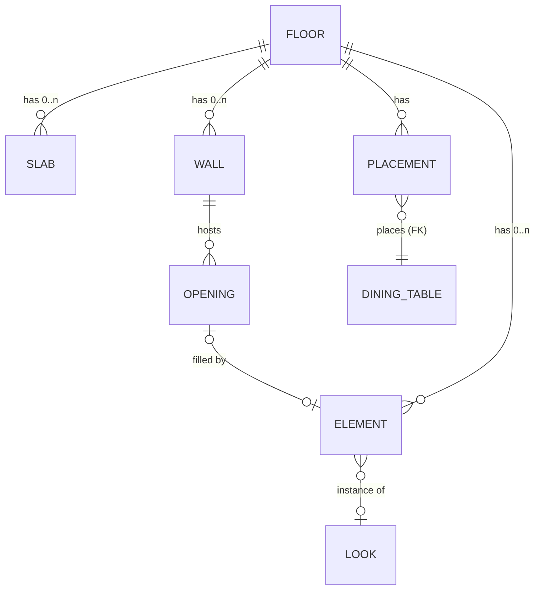

# Studio flexible builder plan

Status: built on 2026-11-14 (D281–D285): Phases 0–4 and saved groups, with free colours, wall and floor finishes and door and window styles (D285); left: the per-floor 3D rebuild (ISS-041 step 3, after measuring on a real device). The split view is dropped (owner D4). Owner decisions D1–D7 below were all decided on 2026-11-14. When accepted, record the architecture change in [decisions](../decisions.md) (it amends D273's floor model) and refresh the index. Bugs and gaps found with this plan: [Studio builder QA](../qa/studio-builder/README.md) (ISS-037 to ISS-046).

## Goal

Let a café owner build their own shop freely, like a game builder, while keeping the precision and data integrity of an architecture tool. Today the editor works, but its model ties the walls to one floor outline, fixes most building sizes in code, and cannot start from an empty floor.

## Main decisions (recommended)

- **Keep 2D for editing; add a live 3D preview beside it** on wide screens. Not 3D-only: exact lengths, measuring, selecting thin walls and touch use are much easier in 2D.
- **Separate walls from the floor surface** (Revit and Sims model): walls, slabs and openings are their own objects, a floor can be empty, and every part can really be deleted.
- **A door is a hole hosted on a wall, with an optional fill** (IFC model: the opening voids the wall, the door fills the opening). The hole stays exact; the look is free.
- **Brick, tile and wood are finishes** on a wall side or a floor surface, never many small objects.
- **Keep whole centimetres and D273's storage**: the floor drawing as JSON (max 64 KB), table placements as rows with their composite foreign key to `dining_tables`.
- **Ship all model changes as one contract version** with one upgrade function.
- **Fix the grid**: levels that change with zoom, drawn in screen pixels.

## What we learned from other tools

| Tool | What it does | What Studio takes |
|---|---|---|
| Revit | Doors and windows are hosted on a wall, cut it and move with it; deleting the wall deletes them | Hosted openings; cascade with a warning |
| IFC | Opening voids the wall; a door fills the opening; an opening can stay empty | Hole separate from fill |
| Archicad | Building materials, layered wall skins (up to 48) | Material as an attribute; no layers |
| Sweet Home 3D | "Magnetism" aligns a door to a wall and sets its depth to the wall thickness | Snap doors into walls; a key turns snapping off |
| Floorplanner | Walls that enclose a space become a room with a surface | Rooms derived from walls, later |
| The Sims 4 | Paint one wall segment or the whole room; cycle grid snapping | Paint tool per wall side, Shift fills the room; snap step key |
| SketchUp | Groups are one-off; components share one definition | Saved groups become shared looks, placed by reference |
| Roblox | Primitive parts with a material and a variant | Simple primitives plus finish variants |

Not copied: Revit and IFC complexity, Archicad layers, physics and full 3D rotation, grid-only placement.

## Current state (main at `06bf118`)

Keep: whole-cm coordinates; D273 storage; shared looks with `RESTRICT`; one version check for the whole layout (409 on stale), autosave, version history; one shared layout and selection for 2D and 3D; openings hosted on edges and inside walls.

What blocks flexibility:

| # | Blocker | Where |
|---|---|---|
| 1 | Floor = one closed outline; each side is a wall. No empty floor; outer walls only become `open` (ISS-045, ISS-046) | `floorSchema` |
| 2 | Two wall systems: outline `edges[]` and inside `walls[]` | contract |
| 3 | Wall thickness (20 / 12 / 4 cm), half wall (110 cm), door (210 cm), window sill and top fixed in code | `designer/geometry.ts` |
| 4 | No height above the floor (`z`) for items, shapes or placements | contract |
| 5 | Shapes are only rectangle and circle | `SHAPE_KINDS` |
| 6 | Furniture geometry fixed per kind; looks change finishes only | `ITEM_KINDS`, `scene/furniture.ts` |
| 7 | Groups are multi-select only, never saved | `designer/group.ts` |
| 8 | No finish on walls or floor surfaces; 16 fixed finishes | `FINISHES` |
| 9 | 200 items, 100 walls, 64 corners, 64 KB per floor | contract |
| 10 | Openings: door or window, offset and width only | `openingSchema` |

## Target design

### Contract v2

Every new field is optional; a missing field means today's behaviour, so old layouts and saved versions keep working.

| Part | Change | Default when missing |
|---|---|---|
| Floor | Can be empty; holds `slabs[]` and one `walls[]` list | — |
| Slab | Floor surface polygon, 0..n per floor, optional finish | Old `outline` becomes `slabs[0]` |
| Wall | One segment `from → to`; kind wall, railing, half, glass; optional `thickness`, `height`, `finishInside`, `finishOutside` | Today's constants |
| Opening | Kind door, window or gap; optional `height`, `sill`, `swing`, `fillLookId` | 210 cm door, today's window heights |
| Item, shape, placement | Optional `z` (cm above the floor) | 0 |
| Shape | New `polygon` kind: points + height + `z` | — |
| Finishes | Wall and floor finishes added to the fixed palette | — |

- **Upgrade:** one pure `upgradeFloor(old) → v2`, used on load and when restoring a version. Old outline → `slabs[0]`; each non-open edge → a wall from corner i to i + 1 with its kind and openings; old inside walls stay. Migrate current rows once. Unit tests: every starter and a saved version upgrade and draw the same in 2D and 3D.
- **New floor:** empty, floor below shown faintly (`showBelow`), plus "Copy walls from floor below". A "Blank" starter for the first floor.
- **Room tool:** one gesture adds a slab and four walls.
- **Delete:** every wall, slab, opening and corner can really be deleted.
- **Check before building:** `streetDoor()` (Explore entrance), roof and 3D cutaway, floor frame bounds for an empty floor (ISS-035), placement warnings, `rooms.ts`, server save validation, the customer Explore view.
- **Server:** the save stays one batch at the version read (409 on stale); the new rules (simple polygon, opening ids unique, limits) live in the shared contract so the editor and the server check the same thing.

### 2D + 3D split view

- Wide screens: the 2D editor with a resizable, collapsible 3D preview beside it, sharing one viewer. Phones keep the 2D | 3D toggle (D273 measured 23–30 ms a frame on the owner's Android phone for 3D alone).
- Keep the 3D view mounted after first show and stop rendering while hidden (ISS-041).
- Rebuild only what changed: surroundings only when the outline or bounds change, then per floor. Measure with `designer/benchmark.ts`.
- Later: simple editing in 3D (select, move on the floor, rotate, paint a wall side).

### Grid

- Levels 1 → 10 → 100 → 1000 cm; minor = smallest level at least 8 px apart on screen; major = minor × 10; minor fades in from 8 to 16 px.
- Lines drawn in screen pixels outside the zoom transform, rounded to whole pixels, `shape-rendering="crispEdges"`; stronger tokens, light and dark checked (ISS-040).
- The grid stays separate from the snap step (1 / 5 / 10 / 25 cm, one key cycles it).

## Phases

Each phase is one PR or a small set, following `AGENTS.md`.

| Phase | Scope | Issues | Depends on |
|---|---|---|---|
| 0. Quick fixes | Street door guard, corner delete, simple-polygon check, opening ids, limits in the editor, dialog text, keep 3D mounted | ISS-037, 038, 039, 042, 043, 044, 041 (step 1) | nothing; can start now |
| 1. Contract v2 and upgrade | Walls separate from slabs, empty floors, real delete, one wall list, optional thickness / height / `z` / opening fields | ISS-045, ISS-046 | D1, D6 |
| 2. Grid, snapping, wall joins | Zoom-based grid, snap step key, snap to wall faces and edges, walls joined as one path | ISS-040, ISS-031, ISS-034 | Phase 1; D5 |
| 3. Openings | Door, window and gap with height, sill and swing; fill look; warn before deleting a wall with doors | — | Phase 1; D3, D6 |
| 4. Finishes, polygon, height | Wall-side and floor finishes, paint tool, polygon shape, `z` in the inspector | — | Phase 1; D2 |
| 5. Split view, saved groups | 2D + live 3D, incremental rebuild, save a group as a look | ISS-041 | Phase 1; D4 |

## Owner decisions

| # | Question | Recommendation | Why |
|---|---|---|---|
| D1 | How does a new floor start? | **Decided (owner, 2026-11-14): empty, floor below as a guide, "Copy walls from floor below" button** | As recommended |
| D2 | Fixed palette or free colours? | **Decided (owner, 2026-11-14): free colours, for everything** (furniture, table looks, walls, floors); recommendation was the fixed palette | Changes the looks contract and 3D materials |
| D3 | Free building for decoration or also structure? | **Decided (owner, 2026-11-14): also structure** (per-wall thickness and height, door and window geometry); recommendation was decoration first | Larger Phase 3 |
| D4 | Split view breakpoint | **Decided (owner, 2026-11-14): no split view**; keep the 2D / 3D toggle everywhere | 3D stays mounted (ISS-041) |
| D5 | Maximum zoom | **Decided (owner, 2026-11-14): keep 25,600 %** (256 px per cm); recommendation was 3,200 % | Grid levels go down to 1 cm |
| D6 | Deleting a wall with doors | **Decided (owner, 2026-11-14): delete its openings silently**; Undo brings them back; recommendation was a warning | Street door still asks (D7) |
| D7 | Street door removed by an edit (ISS-038) | **Decided (owner, 2026-11-14): ask first, then turn Explore off** (recommendation was refuse) | Built in Phase 0; moving a floor keeps its refusal |

## Sources

- [Revit – About Family Templates](https://help.autodesk.com/cloudhelp/2015/ENU/Revit-Customize/files/GUID-E36987A9-A68F-4121-A391-907306BAA60A.htm)
- [AUGI – To Host or Not to Host](https://augi.com/articles/detail/to-host-or-not-to-host)
- [IFC 4.3 – IfcRelFillsElement](https://ifc43-docs.standards.buildingsmart.org/IFC/RELEASE/IFC4x3/HTML/lexical/IfcRelFillsElement.htm)
- [Bonsai BIM – Opening Without Filling](https://docs-unstable.bonsaibim.org/guides/authoring/basic_modeling/opening.html)
- [Archicad – Composite Structures](https://help.graphisoft.com/AC/25/INT/_AC25_Help/020_Configuration/020_Configuration-54.htm)
- [Sweet Home 3D forum – Magnetism](https://www.sweethome3d.com/support/forum/printthread_thread,12772_printall,yes)
- [Floorplanner Editor Manual](https://cdn.floorplanner.com/static/brochures/Floorplanner+editor+manual+version+050718.pdf)
- [The Sims Wiki – Build mode](https://www.thesimswiki.com/wiki/Build_mode_(The_Sims_4))
- [SketchUp – Architectural Design with SketchUp](https://www.oreilly.com/library/view/architectural-design-with/9781118385982/9781118385975c03.html)
- [Roblox – Part API](https://developer.roblox.com/api-reference/property/Part)
