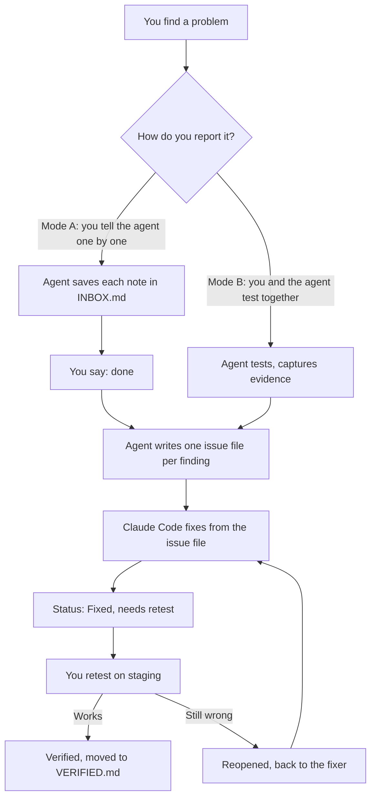

# QA guide for people

This page explains how QA works in this project, in plain words. The strict rules for agents are in [STANDARD.md](STANDARD.md). You do not need to read that file to use QA.

## What QA is here

You look at the app, find things that are wrong or missing, and write them down. An agent fixes them. Then you check the fix. Nothing is "done" until you check it.

Everything is kept in the repo as Markdown files. There is no other tracker. If it is not in a file, it did not happen.

## The big picture



## Who does what

| Who | Job |
|---|---|
| You (owner) | Find problems. Decide what the app should do. Retest. Only the tester can say "Verified". |
| QA agent (GPT or Claude in a browser) | Helps you test. Takes notes. Writes issue files. Never edits app code. |
| Fixer (Claude Code) | Reads the issue file. Fixes only that. Adds a test. Sets "Fixed, needs retest". Never says "Verified". |

## Two ways to start

Say one line to the agent when you start.

**Mode A: you report, the agent collects.**
Say: `QA mode A, area studio`
Then tell the agent each problem as you see it, one by one. It saves your words in `docs/qa/<area>/INBOX.md`. When you are finished, say `done`. The agent turns the notes into issue files. If a note is not clear, it asks you questions and marks the issue "Needs details".

**Mode B: we test together.**
Say: `QA mode B, area studio`
The agent opens the browser and follows steps with you. It compares the app with the reference (for example Figma). It takes screenshots and GIFs and writes the issue files at the end.

Both modes end with the same files. The issue file says which mode found it, so the fixer knows how much to trust the steps.

## What the files are

```text
docs/qa/
  GUIDE.md           this page
  STANDARD.md        the strict rules (for agents)
  RETEST-QUEUE.md    fixed items waiting for your retest
  VERIFIED.md        items that passed your retest
  _templates/        blank forms for issues, checks, retests, inbox, agent prompt
  <area>/
    README.md        goal, reference and one table of all issues
    INBOX.md         raw notes while you report (Mode A)
    issues/          one file per problem
    checks/          one file per tool, step by step
    evidence/        screenshots and GIFs
    SMOKE.md         about 10 checks to re-run before a release
```

## What the statuses mean

| Status | In plain words |
|---|---|
| Open | Found. Ready to fix. |
| Needs details | We do not know enough yet. The questions are listed in the file. |
| Needs owner decision | The agent cannot choose. You must decide. |
| In progress | The fixer is working on it. |
| Fixed, needs retest | Built. Waiting for you to check. Not finished. |
| Verified | You checked it and it works. |
| Reopened | You checked it and it is still wrong. |
| Not reproduced | The fixer could not see the problem. Send exact steps. |
| Won't fix | We decided not to build it. The reason is written down. |
| Closed, not built | Done differently or not needed. Nothing to test. |

## What a good report looks like

You do not need perfect reports. Say what you see. The agent will ask for the rest. These help most:

- Where you were (page, zoom, what was selected).
- What you did, step by step.
- What you expected (for example "Figma keeps the zoom").
- What happened instead.
- A screenshot or GIF.

## What a retest looks like

1. Open the fixed item in `RETEST-QUEUE.md`.
2. Open the staging app. Use a real mouse or trackpad.
3. Follow "How to verify" exactly. Save new screenshots.
4. All steps pass: the item is "Verified" and moves to `VERIFIED.md`.
5. Any step fails: the item is "Reopened". Write what still happens.

Some steps an agent cannot do (hold a key while dragging, trackpad pinch, exact timing). The queue marks these "By hand". You do them.

## Safety rules for testing

- Use test data or a scratch page. Do not change real customer, order or payment data.
- Do not press Save, Publish or Delete on real data unless you said it is allowed.
- Put the app back the way you found it.
- Never write a password or token in a file or a screenshot.

## Questions

**Why are the issue files kept in the repo?**
So any agent, now or later, can read exactly what was found, with the evidence, and nothing depends on a chat.

**Why can the fixer not mark "Verified"?**
Because the person who builds a fix should not be the only one who says it works. A second check finds mistakes.

**Is there a spreadsheet?**
Not any more. The first QA round used a Claude Sheet, "Figma vs Studio — Behavior Audit", as the tester's working index. It is retired and may be archived. The repo is the only source of truth. The table in each area's README is the index, and it is what any agent should read and update.

**How does a new agent know all this?**
`AGENTS.md` has a row for QA that points to `STANDARD.md`. You can also start with the mode line above.

**Where do I start for a new area?**
Copy the layout in [README.md](README.md), then use Mode A or Mode B.
