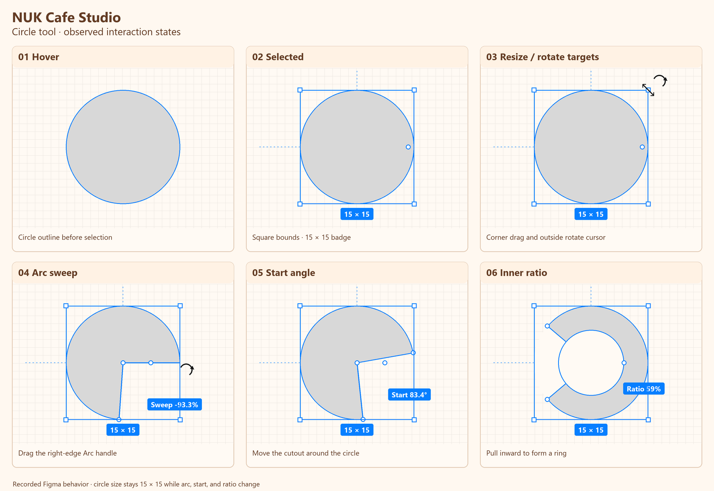

# CIRC-01 · Circle arc and ring controls

- Date: 2026-11-13
- Status: Fail (compared 2026-11-13; finding ED-06)
- Figma reference: [Wireframe scratch file](https://www.figma.com/design/sOEIGbUssGCpJIkm5dSNsP/Wireframe)
- Source: [35-second circle recording](https://chatgpt.com/library?file_id=libfile_36d13fd676a08191aae494d3c6cba2c3&account_id=personal)

## Final mockup

The single image redraws the observed states at a readable size. The recording is authoritative for exact motion, cursor changes, values, and timing. The resize and rotation panel shows hover targets; the clip does **not** demonstrate a completed resize or rotation.

## Start state

Use a plain filled circle on a 2D scratch layout, initially unselected. The Figma example displays `15 × 15` when selected. Keep the same view and zoom while testing each handle.

## Recorded sequence

| Time | Action and observed feedback |
|---|---|
| 0:00–0:02 | Hover the circle: a thin blue perimeter appears with an ordinary pointer. Click: square bounding box, four corner handles, dotted guides from the left and top midpoints, centered `15 × 15` size badge, and a distinct round handle near the right edge. |
| 0:04–0:09 | Hover the bounding-box corner: diagonal resize cursor. Move just outside that corner: curved rotate cursor. The clip samples these targets but does not drag them. |
| 0:10–0:21 | Hover the round right-edge handle: `Arc` feedback. Drag to change the sweep. A wedge opens and the live label shows values including `Sweep -93.3%`, `-71.7%`, `-85.5%`, and `-81.1%`. The outer bounds and `15 × 15` badge remain. |
| 0:22–0:27 | Drag the start handle around the perimeter: `Start 0°`, `119.2°`, and `83.4°` appear. The wedge moves around the same circle without changing its outer dimensions. |
| 0:28–0:33 | Drag the ratio handle inward: the sector becomes a ring segment. The label changes through `Ratio 59%`, `54.5%`, and `85.5%`. The inner opening grows while the outer bounds stay `15 × 15`. |
| 0:34–0:35 | Deselect: the gray final ring segment remains without guides, handles, or a badge. |

## Studio comparison

Studio run: 2026-11-13, local e2e build of `main` at `36cc911` (PR #312), Playwright's Chromium 1440 × 900, Layout Lab "Lab Floor" from the Rooftop starter, a 100 × 100 cm Shape (S, click) and a 100 cm round Shape (O, click), zoom 99 % unless noted. Pointer positions and cursors read with `elementFromPoint` in the page. No real mouse or trackpad.

| Step | Result | What happened | Evidence |
|---|---|---|---|
| Hover, select | Pass | Outline on hover; frame and four corner handles when selected, like the rectangle (same ED-02, ED-03, ED-04 apply). | [studio-01](../evidence/CIRC-01/studio-01-circle-selected.png) |
| Arc, start, ratio | Fail (ED-06) | No arc, start or ratio handle and no such fields: Studio's round shape (`block-round`) is a full ellipse with name, height and finish only. | [studio-01](../evidence/CIRC-01/studio-01-circle-selected.png) |
| Name label | Fail (ED-09) | The default name "Round block" is wider than a 100 cm circle and runs past its edge. | [studio-01](../evidence/CIRC-01/studio-01-circle-selected.png) |

## How to verify

1. Check that the round Arc target, square resize handle, and outside rotation region are individually reachable and predict the correct action before pressing. Do not treat the clip's hover samples as proof that resize or rotation was completed.
2. Drag the arc handle and confirm that sweep changes the visible sector and its live label while the circle's outer dimensions remain fixed.
3. Move the start handle and confirm that the opening changes position without changing sweep, ratio, or outer bounds.
4. Drag the ratio handle from zero toward a thin ring. Confirm that it changes inner radius, preserves the outer circle and current arc, and keeps the value in sync with Properties.
5. Deselect, reselect, and repeat at two zoom levels. Check the final shape and handle hit areas after reselecting.

## Open questions

- The video does not establish the modifier keys, snapping rules, or exact cursor style for every drag. Verify those separately.
- It does not show a non-circular ellipse, a completed resize or rotation, or persistence after save/reload. Those need separate Studio checks.
