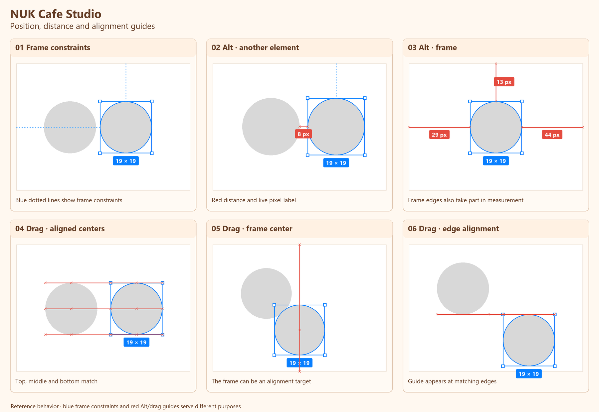

# GUIDE-01 · Frame constraints, Alt distances and drag alignment

- Date: 2026-11-13
- Status: Needs comparison in Studio
- Source: owner's Figma screenshots and explanation, 2026-11-13
- Figma reference: [Wireframe scratch file](https://www.figma.com/design/sOEIGbUssGCpJIkm5dSNsP/Wireframe)

## Final mockup

The image redraws six representative states for readability. The original screenshots and the owner's explanation are authoritative for exact line placement and pixel labels. The example values `8 px`, `13 px`, `29 px` and `44 px` illustrate Figma's labels; Studio must display its own actual measurement and unit.

## Three distinct behaviors

| Mode | Trigger | Feedback | Reference |
|---|---|---|---|
| Frame constraints | Select an element inside a frame | Blue dotted horizontal and vertical lines visualize its current constraints to the parent frame. They are not smart alignment guides. | Panel 01 |
| Alt distances | Select an element, hold Alt and point at another element | Red segments and live numeric labels show the distance to the other element. The frame also participates: gaps can be shown to its edges. | Panels 02–03 |
| Drag alignment | Move an element near an alignment position | Transient red guides show matching edges and centers relative to other elements or the frame. Equal-sized neighboring circles can show top, middle and bottom guides at once; other examples show a frame center or one matching edge. | Panels 04–06 |

Figma's [Constraints help](https://help.figma.com/hc/en-us/articles/360039957734-Apply-constraints-to-define-how-layers-resize) identifies the blue dotted lines as the current frame constraints. The red guidance considers relevant elements **including the frame**. It helps locate the selected or moving element relative to its surroundings. Distance labels describe separation; alignment guides describe matching positions. Do not interpret every red line as a snap or a distance label.

## Studio comparison

The Studio run is pending. D278 PR 3 already added smart guides and Alt distances, so compare the existing implementation with these examples before proposing changes. Record the Studio build, browser, zoom, pointer/keyboard state, and screenshots of each discrepancy.

## How to verify

1. Select a child of a frame and open Position → Constraints. Check that the blue dotted lines correspond to the chosen horizontal and vertical constraints; repeat with Left/Top and Center/Center. An element outside a frame has no parent-frame constraints to visualize.
2. Select one element, hold Alt, then hover several neighbors and empty space. Check that the red distance segments and labels update for the actual hovered target and disappear when Alt is released. Include the frame's top, bottom, left and right edges.
3. Drag one element near another. Check edge-to-edge, center-to-center, and three simultaneous top/middle/bottom alignments. Move away and confirm transient guides clear.
4. Drag near the frame's center and edges. Check whether the frame participates as an alignment target and whether the guide corresponds to the actual position.
5. Repeat at different zoom levels and with unequal-sized or rotated elements. Verify that labels match geometry and the project's chosen layout units; a Figma pixel value is not a hardcoded Studio value.

## Still to establish

- The exact target priority when several possible edges, centers, or frame boundaries are close.
- Whether every visible alignment guide snaps the move or merely provides feedback.
