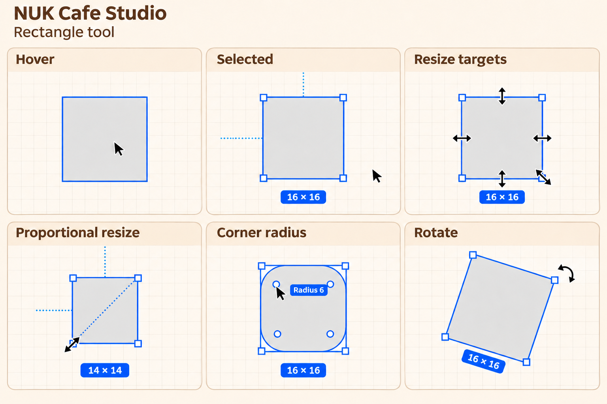

# RECT-01 · Rectangle selection and transforms

- Date: 2026-11-13
- Status: Fail (compared 2026-11-13; findings ED-01 to ED-05, ED-09)
- Figma reference: existing square in the [Wireframe scratch file](https://www.figma.com/design/sOEIGbUssGCpJIkm5dSNsP/Wireframe?node-id=79-89)
- Source: [53-second Figma recording](https://chatgpt.com/library?file_id=libfile_f15535c76fc08191a363778f4c4c7b33&account_id=personal)

## Final mockup

The Resize targets panel shows the possible cursor positions together. In Studio, display only the cursor for the target under the pointer.

## Start state

Use a single unrotated, sharp-cornered rectangle in a 2D scratch layout. The Figma example starts at a displayed size of `16 × 16`. In Studio use an equivalent square in layout units and zoom until the inner dot, boundary handle, and outside corner are individually reachable. Start with the Move tool and no selection. The recording is cropped to the canvas and begins with the pointer already over the rectangle.

## Steps and expected behavior

| Step | Pointer target and action | Expected editor feedback | Figma recording |
|---|---|---|---|
| 1 | Hover over the unselected shape | Thin outline along the shape. The ordinary arrow remains visible. The selection handles and size badge appear after clicking. | 0:00 hover |
| 2 | Click the shape, then move the pointer over and away from the selection | Show a bounding box with four square corner handles and a centered `16 × 16` badge below it. Dotted horizontal and vertical guides extend from the midpoints of the left and top edges. The four round radius dots show inside the box when hovering the selection and hide when the pointer moves away. The box and badge stay visible while selected. | 0:03 selected, video 0:03–0:07 |
| 3 | Hover each edge and square handle before pressing | Left and right edges use a horizontal double arrow. Top and bottom use a vertical double arrow. Each square corner uses the diagonal double arrow matching its axis. The sides are reachable directly along the outline. | 0:10.5 side, 0:13.5 top, video 0:07–0:21 |
| 4 | Drag the bottom-left square handle with proportions constrained | The top-right corner stays anchored in the recorded drag. The width and height update together and a dotted diagonal connects the opposite corners. The clip shows `14 × 14` and reaches `10 × 10`. Radius dots hide during the active resize. | 0:22.5 corner resize, video 0:21–0:28 |
| 5 | Drag the left edge with proportions constrained | The right edge stays anchored in the recorded drag. The vertical extent changes with the width, the cursor stays horizontal, and the diagonal guide and live size badge are visible. The clip shows `11 × 11` and reaches `17 × 17`. | 0:30 edge resize, video 0:28–0:35 |
| 6 | Hover the upper-left inner dot, press and hold, then drag inward and back | The inner dot is a distinct radius target with radius cursor feedback. All four corners round together and the four dots move inward. A floating `Radius 3` or `Radius 6` tooltip sits near the active dot, with a visible gap and **no connector line, stem, or tail**. The box and separate size badge stay `16 × 16`. Dragging back reaches `Radius 0`. | 0:39 corner radius, video 0:35–0:41 |
| 7 | Move just outside a corner, hover, then drag. Release, deselect, and reselect | The cursor changes to curved rotation arrows before pressing. The shape, selection box, corner handles, and size badge rotate together. The size remains `16 × 16`. Reselecting restores the box at the new angle. | 0:48 rotate, video 0:41–0:53 |

## Actual Studio behavior

Studio run: 2026-11-13, local e2e build of `main` at `36cc911` (PR #312), Playwright's Chromium 1440 × 900, Layout Lab "Lab Floor" from the Rooftop starter, a 100 × 100 cm Shape (S, click) and a 100 cm round Shape (O, click), zoom 99 % unless noted. Pointer positions and cursors read with `elementFromPoint` in the page. No real mouse or trackpad.

| Step | Result | What happened | Evidence |
|---|---|---|---|
| 1 Hover | Pass | Thin outline on hover (`plan-hover`), ordinary arrow. | — |
| 2 Select | Fail (ED-04) | Frame and four square corner handles. No size badge under the selection: a size shows only beside the pointer during a resize. No dotted guides (Studio has no frame constraints, see ED-08). At the default fit zoom (32 %) a 100 cm piece is 32 px wide and shows **no handles at all** (ED-03). | [studio-01](../evidence/RECT-01/studio-01-selected-no-size-badge.png) |
| 3 Edge and corner cursors | Fail (ED-01) | Corners: `nwse-resize` (turned with the piece, ISS-030). Edges: plain arrow; there is no edge resize. | — |
| 4 Corner resize, Shift | Pass | Shift keeps the ratio: 100 × 100 → 60 × 60, live label `60 × 60 cm` beside the pointer. Badge placement differs (ED-04). | [studio-03](../evidence/RECT-01/studio-03-shift-corner-resize.png) |
| 5 Edge resize | Fail (ED-01) | A drag on the left edge **moves** the piece 40 cm instead of resizing it. | — |
| 6 Corner radius | Fail (ED-05) | No radius dots, no radius in Properties. Studio's rectangle is always sharp. | [studio-02](../evidence/RECT-01/studio-02-no-radius-dots.png) |
| 7 Rotate just outside a corner | Fail (ED-02) | 10–12 px outside the corner the pointer is still on the resize handle's hit area: the drag resized to `60 × 130 cm`. Rotation starts only 12–32 px out (`ROTATE_ZONE_OFFSET_PX`). | [studio-04](../evidence/RECT-01/studio-04-outside-corner-resizes.png) |

Earlier audit issues for the same steps:

| Existing audit issue | Related check |
|---|---|
| [ISS-032](../../studio-figma/issues/ISS-032.md), selection and hover outline | Steps 1–2 |
| [ISS-030](../../studio-figma/issues/ISS-030.md), tool and handle cursors | Steps 3–7 |
| [ISS-015](../../studio-figma/issues/ISS-015.md), resize modifiers | Steps 4–5 |
| [ISS-029](../../studio-figma/issues/ISS-029.md), live size label | Steps 4–6 |
| [ISS-033](../../studio-figma/issues/ISS-033.md), rotation target | Step 7 |

## Fix direction and how to verify

1. Compare the same fixture on the Studio branch before implementing changes. Capture the pointer immediately before pressing and at least one frame during each drag. Use those captures to document the comparison results here.
2. Test the three neighboring targets independently at each corner. Start at the inner dot, move onto the square handle, then move just outside it. Confirm the cursor predicts the next action and only the intended property changes during the drag.
3. Test each edge with and without the proportion constraint. Verify the constrained behavior against steps 4–5. For the free-resize Studio requirement, check that a left/right drag changes width and a top/bottom drag changes height. Repeat with a non-square rectangle to distinguish keeping the existing ratio from forcing a square.
4. Verify that the radius tooltip floats on hover and updates live during the drag. Check that the corner radius, displayed dimensions, and inspector values agree with the canvas. Verify that rotation changes the angle and keeps the rectangle's dimensions.
5. Repeat at two zoom levels. Capture the same cursor targets and labels after any fix.

## Open questions

- The clip does not show which key or setting enabled proportional resize, or what triggers the dotted horizontal and vertical guides. Verify those triggers independently.
- The clip demonstrates the left-edge resize and samples cursor directions. Drawing from the shape menu, free resize, all opposite-side drag cases, single-corner radius edits, and angle snapping need their own verification.
- Figma's handle hit size, the rotate area's reach and the size below which Figma hides handles are not measured; ED-02 and ED-03 need those numbers before the fix.
